# perses-plugin-depmap

A [Perses](https://perses.dev) panel plugin, `DependencyMapChart`, for moving old, badly documented
software out of a classic data centre, including estates that are only partly on Kubernetes. It draws
what really talks to what, discovered from network traffic rather than documentation, and answers the
questions a migration has to answer:

- What breaks if this server or service goes down, with its HA setup (primary/standby, active-active,
  quorum) taken into account?
- Which clients are **hard-wired** to one node of an HA service, so failover cannot help them?
- What does this service need, so it can move together?
- Which connections cross between the old data centre, the new VMs and outside once a wave moves,
  as firewall rules per instance?
- Which dependencies are rare (the monthly batch job) or unknown (the IP nobody owns)?
- In a hybrid estate: which old VMs call into the cluster, which pods call back out to old VMs, and
  what is the whole path, VM to pod to VM?

The data comes from Prometheus, through the upstream Prometheus datasource: network flow metrics from
[OpenTelemetry eBPF Instrumentation](https://opentelemetry.io/docs/zero-code/obi/) (OBI) where it can
run (on servers, on container hosts and as a DaemonSet on Kubernetes nodes), and a small snapshot
script everywhere else. The kit for all of them is in [collect/](collect/).

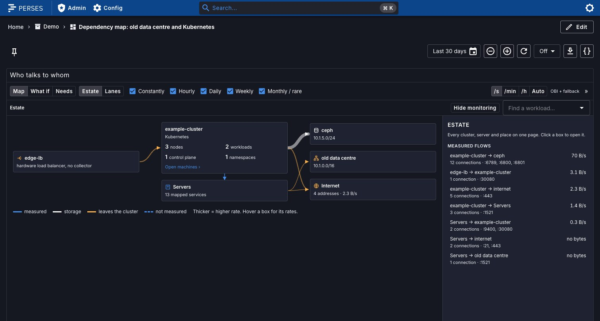

| Cluster: control plane, workers, cluster network | Storage place page (Ceph) | Dependencies of a workload |
| --- | --- | --- |
| 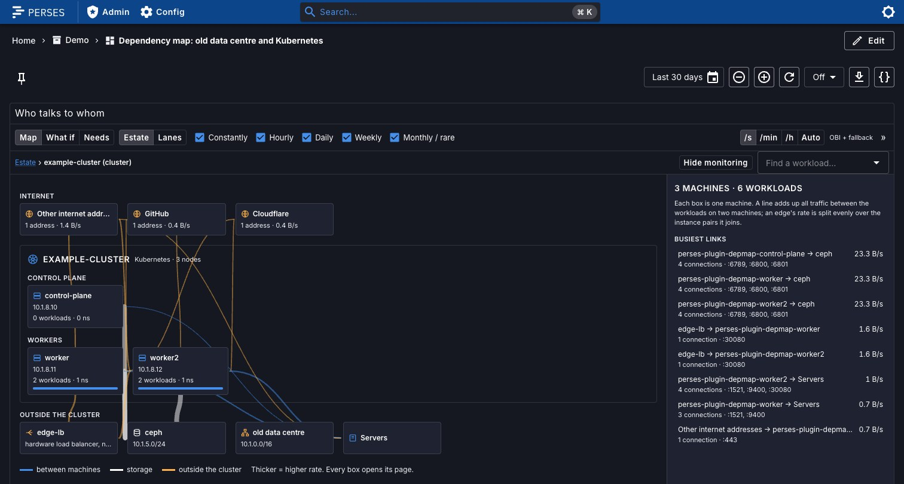 | 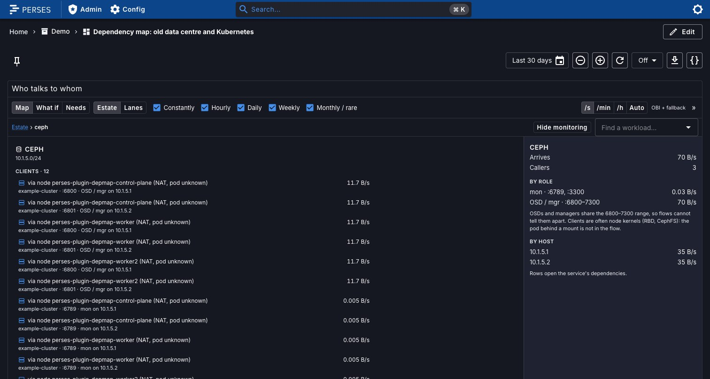 | 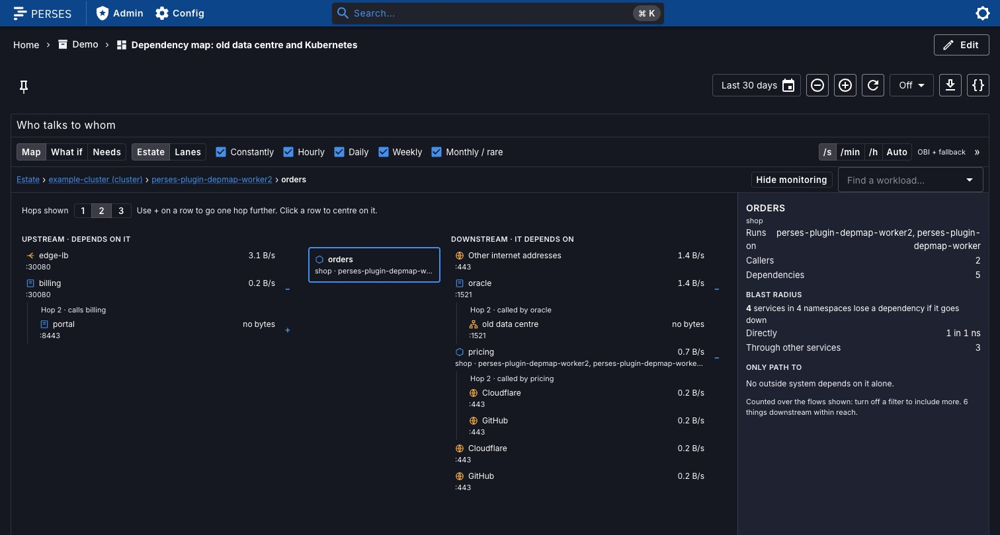 |
| 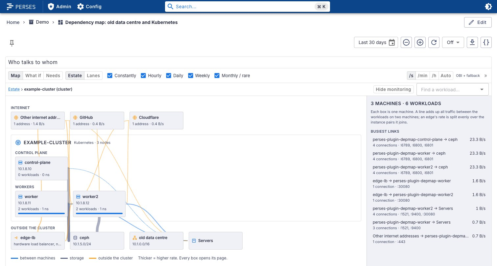 | 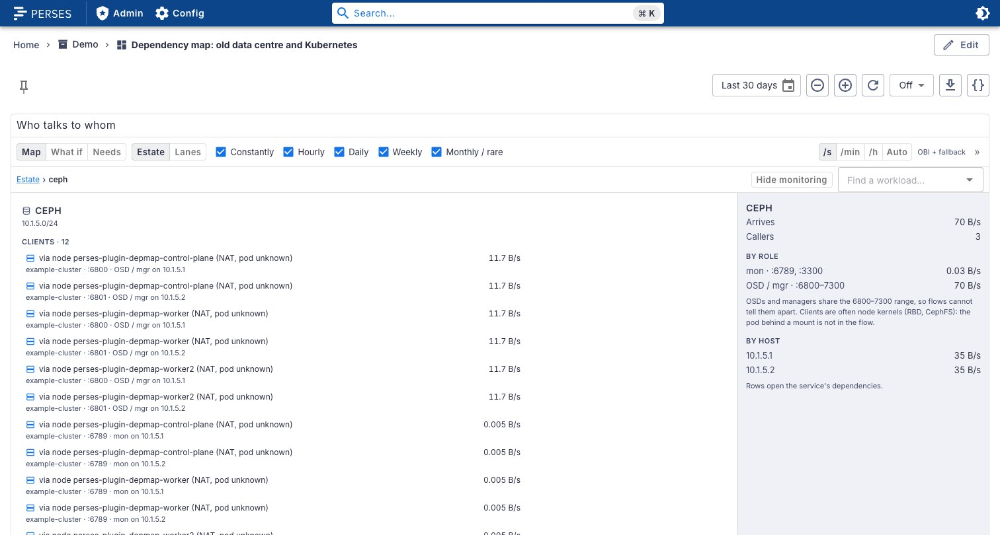 | 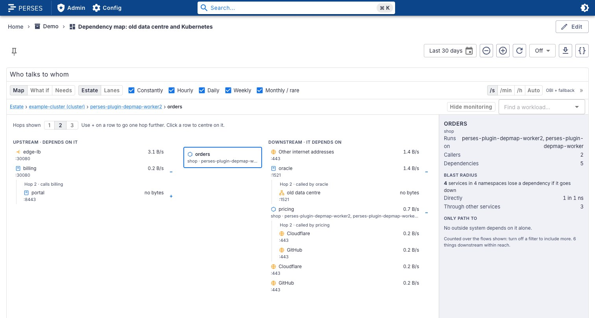 |

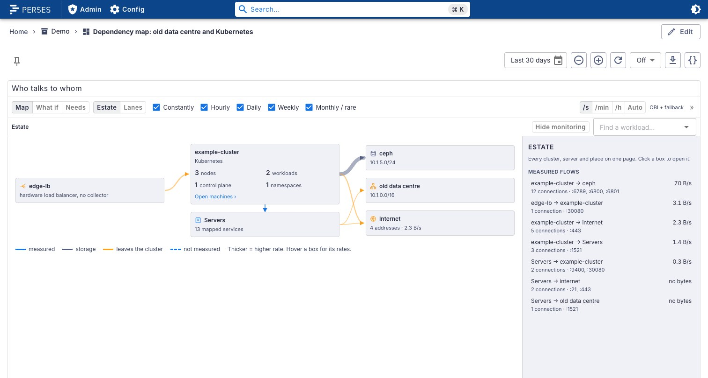

The lanes view, for migration waves:

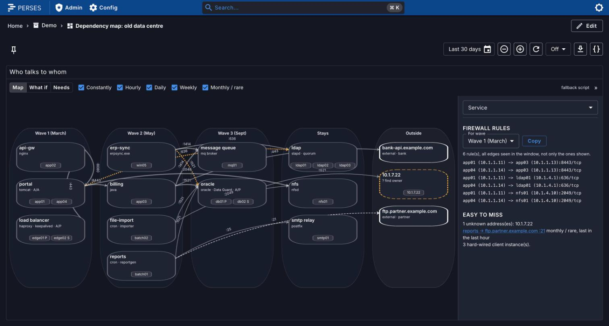

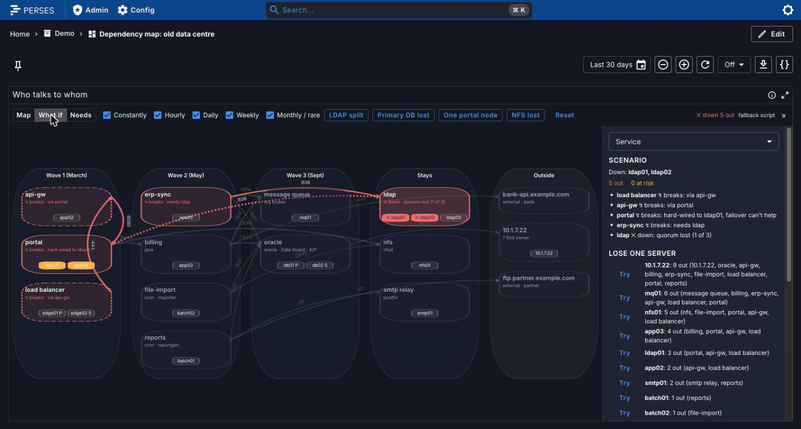

| Light theme, map | Light theme, what if |
| --- | --- |
| 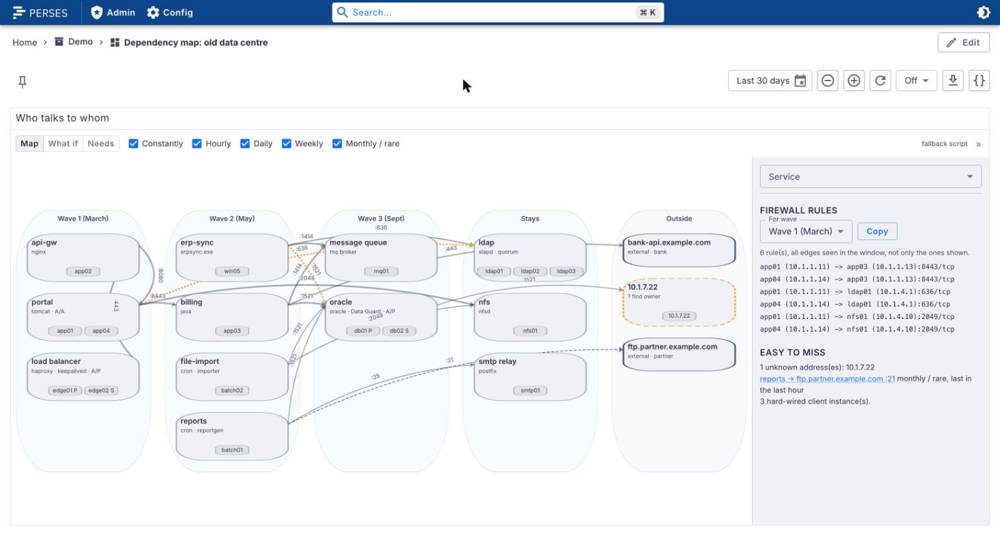 | 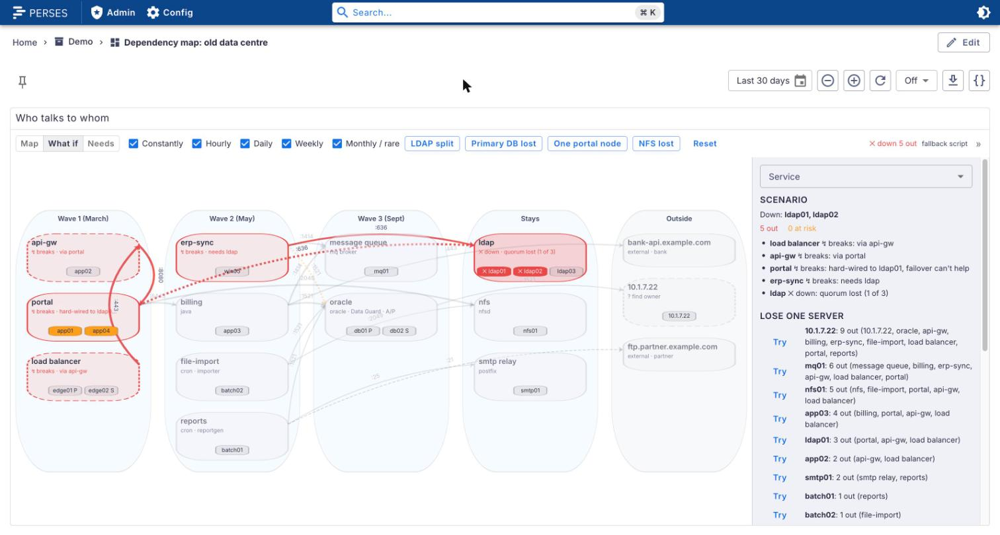 |

The screenshots come from the [dev/](dev/) stack: a made-up estate of twenty containers with 30 days
of history, collected by the fallback script. The hybrid screenshots are further down, in
[Hybrid estates](#hybrid-estates).

## Supported versions

| Plugin | Perses | Status |
| --- | --- | --- |
| 0.2.x | v0.55.x | Tested with v0.55.1 |
| 0.1.x | v0.55.x | Tested with v0.55.1 |

Built against `@perses-dev/*` 0.55.1 and `percli` v0.55.1. Data collection was written against OBI
v1.0.0.

## What it does

The panel has three modes, picked in its toolbar. Map opens in one of two views, **Estate** or
**Lanes**.

**Map, Estate.** A drill-down from the whole estate to a single workload, with navigation inside the
panel:

- **Estate:** callers outside (clients), load balancers, one block per Kubernetes cluster (grouped by
  the cluster label, `k8s_cluster_name` by default) and the mapped servers, then storage, LANs, other
  private addresses and the internet. Lines are measured flows, thicker for higher rates. A load
  balancer's `forwardsTo` that no flow confirms is drawn dashed and labelled "not measured".
- **Cluster:** the internet providers its pods and nodes call (top five, then "+N more"), the
  machines in control plane and workers, the cluster network (Service addresses, pods whose node is not
  known), and everything outside the cluster, other clusters included.
- **Machine:** one card per namespace with its workloads as fixed-width chips (eight, then "+N more").
  A blue outline marks a workload that talks to another machine.
- **Place pages:** a load balancer, storage (by role and by host for Ceph), a LAN, an internet
  provider (the busiest addresses by name, the rest counted), the mapped servers (with a button to the
  lanes view).
- **Dependencies:** what calls a workload and what it calls, one to three hops (or + on a row), its
  blast radius, and the outside systems for which it is the only path.

Breadcrumbs go back up; the search box finds any workload, machine or place. **Hide monitoring**
hides flows of namespaces and workloads matching `monitoringPattern`. Long names are cut with an
ellipsis and shown whole in a tooltip. An edge's rate is split evenly over the instance pairs it
joins when it is drawn between machines.

**Map, Lanes.** Services from your mapping in columns: one per migration wave (moving to new VMs), then what
stays in the old data centre, then what is outside (externals and unknown IPs). Each node shows its
name, owner, HA type and instances. Edges point from caller to callee:

| Edge | Means |
| --- | --- |
| solid | seen at least daily |
| dashed | weekly or monthly (rare) |
| dotted, warning colour | hard-wired: the caller only ever connected to one member of an HA service |

Hover an edge for its port, frequency (seen in how many of the window's hours), average rate (OBI)
and last seen. Rates are averaged over the window and shown per second by default; the toolbar switches
between per second, minute, hour and automatic. Click a service or edge for details in the side panel. Checkboxes in the toolbar hide
frequency classes (constantly, hourly, daily, weekly, monthly / rare), and the panel says how many
edges are hidden.

**What if.** Every node shows its instances as chips (`P` and `S` for primary and standby). Click a
chip to take that instance down, again to bring it back; take down as many as you like, or pick a
preset. The panel evaluates every service:

| HA type | Rule |
| --- | --- |
| `single` | instance down: service down |
| `active-passive` | primary down, standby up: failing over. Standby down only: degraded, no failover left. Both down: down |
| `active-active` | fewer than `minUp` up: down. Otherwise the survivors need `load × n / up` percent: over 100 is overloaded, else reduced |
| `quorum` | a majority up: degraded. Otherwise down |

Then it follows the callers: a caller of a down service breaks, and so does a caller hard-wired to a
down instance even if the service failed over; their callers break through them, transitively. Callers
of a failing-over or overloaded service are at risk. Every affected node says why ("hard-wired to
ldap01, failover can't help", "quorum lost (1 of 3)", "needs 130% capacity"). Every state has a text
label and a symbol, not only a colour: `✕ down`, `↯ breaks`, `⇄ failing over`, `▲ overloaded`,
`◐ degraded`, `◐ reduced`, `△ at risk`, `● ok`.

**Needs.** Click a service to light up everything it depends on, transitively: the set that must move
with it or stay reachable from where it moves to.

The map works from the keyboard: Tab into it and every service is offered as a button over the map;
Enter or Space selects it, as a click would.

The side panel (open by default on wide panels, behind **Show details** on narrow ones) has:

- **Scenario:** counts (out, degraded or at risk, unaffected) and the affected services with reasons.
- **Lose one server:** every single instance tried down on its own; the ones that take any service
  out, worst first, each with a **Try** button. Then every hard-wired client.
- **Service details:** owner, HA type, VIP, load, instances (as toggles in What if), inbound and
  outbound connections, and a wave selector that moves the service between columns live. That is
  planning only; **Copy updated mapping** copies the mapping with the new waves, comments kept.
- **Firewall rules** for a chosen wave: for every connection that crosses between the new VMs, the
  old data centre and outside once that wave has moved, one line per instance
  (`app01 (10.1.1.11) -> ldap01 (10.1.4.1):636/tcp`). Callers of a VIP get a rule to every member and
  the VIP; a hard-wired caller gets only its member. **Copy** puts the list on the clipboard.
- **Easy to miss:** rare edges, addresses nobody owns (shown as `? find owner`), and hard-wired
  instances.

## Data it expects

Two sources, both optional; the panel queries both and merges them. Exact metric and label names are
in [docs/metrics.md](docs/metrics.md).

| Source | Metric | Where |
| --- | --- | --- |
| OBI network flows | `obi_network_flow_bytes_total` with `src_address`, `dst_address`, `server_port`, and on Kubernetes nodes the `k8s_*` labels | Linux with kernel 5.8+ (or RHEL 4.18+ with eBPF backports) and BTF, run as root: on the server, in a privileged container, or as a DaemonSet |
| Snapshot script | `depmap_connection_seen` with `src_host`, `src_ip`, `src_process`, `dst_ip`, `dst_port`, `direction` | Any Linux with `ss`, or Windows with PowerShell 5+, through the node_exporter / windows_exporter textfile collector |

The panel runs range queries with a one-hour step over its window (the dashboard's time range unless
`window` is set). An edge's
frequency class is the share of those hours it was seen in. Prometheus must keep at least the window:
`--storage.tsdb.retention.time=35d`.

### The mapping

Traffic gives IPs and ports. The mapping, pasted into the panel's **Mapping** option as YAML or JSON,
gives them meaning. Start from [collect/mapping.example.yaml](collect/mapping.example.yaml); its schema
is [collect/mapping.schema.json](collect/mapping.schema.json).

```yaml
services:
  - id: db                 # required, unique
    name: orders database  # defaults to id
    owner: DBA team
    wave: 3                # 0 = stays in the old data centre, 1..n = migration wave
    ha: active-passive     # single (default) | active-active | active-passive | quorum
    vip: 10.0.2.10         # optional virtual address
    instances:
      - { host: db01, ip: 10.0.2.1, role: primary }   # role: primary | standby | member
      - { host: db02, ip: 10.0.2.2, role: standby }
  - id: portal
    ha: active-active
    minUp: 1               # active-active: instances that must be up (default 1)
    load: 65               # % of total capacity, or loadQuery: '<PromQL returning %>'
    instances: [{ host: web01, ip: 10.0.1.11 }, { host: web02, ip: 10.0.1.12 }]
external:
  - { match: 198.51.100.21, name: ftp.partner.example.com, owner: partner }  # IP, CIDR or name
```

An address in the traffic that matches no instance, VIP or external is drawn as an unknown node with
its IP. Mistakes in the mapping are listed in the panel with their path; the valid part still draws.

An optional `kubernetes` section adds clusters and the services running in them. It has no pod
addresses: OBI on the nodes reports every flow with the pod's namespace and workload, and services
are matched on those, so pods can come and go. Mappings written for 0.1 stay valid.

```yaml
kubernetes:
  clusters:
    - name: example-cluster          # as OBI reports it (k8s_cluster_name)
      nodes:                         # ip: the address the rest of the network sees
        - { name: node-1, ip: 10.0.8.1 }
        - { name: node-2, ip: 10.0.8.2 }
      egressIps: [10.0.8.100]        # optional: pod traffic leaves through these, not the nodes
      hideNamespaces: [kube-system]  # the default
  services:
    - id: orders
      namespace: shop
      workload: orders               # Deployment / StatefulSet / DaemonSet name or glob; default the id
      services: [orders]             # Kubernetes Services in front of it; default the workload name
      replicas: 3                    # HA: active-active over the desired replicas
      minUp: 2                       # default 1
      nodePorts: [30080]             # node:30080 from outside is a call to orders
      loadBalancerIp: 10.0.8.200     # optional
```

Pods of workloads the mapping does not name still appear, one node per workload, named after it and
grouped with its namespace.

An optional `places` section names the addresses that are neither servers nor pods, for the estate
view. Each place has a `name`, a `match` list (IPs or CIDRs) and an optional `note`; an address
belongs to the first place that matches, in the order below.

```yaml
places:
  loadBalancers:
    - name: edge-lb
      match: [10.0.9.10]
      forwardsTo: [example-cluster]  # clusters or places; dashed until a flow confirms it
  storage:
    - name: ceph
      preset: ceph                   # splits clients by role (mon :6789/:3300, OSD/mgr :6800-7300)
      match: [10.0.5.0/24]
  lan:
    - name: data centre
      match: [10.0.0.0/16]
  internet:                          # optional: built-in ranges for GitHub, Cloudflare, Google,
    - name: GitHub                   # Fastly and Quad9 apply without it; [] turns them off
      match: [140.82.112.0/20]
```

The panel editor copies the built-in providers as YAML (**Copy default providers**), to edit them
here. Other private addresses are "Other private addresses"; other public ones "Other internet
addresses"; outside callers that are never called are "Clients".

## Options

| Option | Default | |
| --- | --- | --- |
| `datasource` | default Prometheus datasource | A Prometheus datasource selector or variable |
| `queries.edge` | OBI query, see [docs/metrics.md](docs/metrics.md) | Bytes per hour per caller, callee and port. Empty turns it off |
| `queries.fallback` | snapshot script query | Empty turns it off |
| `queries.volume` | none | Bytes per hour per edge from another source |
| `mapping` | `services: []` | The mapping, YAML or JSON |
| `window` | dashboard time range | Observation window, ending at the dashboard's end time, e.g. `30d`. Rates and frequencies are computed over it |
| `frequencyThresholds` | `constantly: 0.9`, `hourly: 0.2`, `daily: 0.02`, `weekly: 0.004` | Minimum share of the window's hours per class; less than `weekly` is monthly / rare |
| `lanes.waveLabels` | `Wave 1`, `Wave 2`, … | Label per wave number, e.g. `{"1": "Wave 1 (March)"}` |
| `lanes.stayLabel` | `Stays in old DC` | |
| `lanes.externalLabel` | `External / unknown` | |
| `lanes.showExternal` | `true` | Draw externals and unknown IPs |
| `edgeFilter` | all classes | Frequency classes shown when the panel opens |
| `linkTemplates.node` | none | Link in a service's details. `${service}`, `${name}`, `${host}`, `${hosts}` |
| `linkTemplates.edge` | none | Link in an edge's details. `${source}`, `${target}`, `${port}` |
| `scenarios` | none | Presets: `[{name: "LDAP split", down: [ldap01, ldap02]}]`. Without any, the worst single servers are offered |
| `defaultMode` | `map` | `map`, `failure` (What if) or `needs` |
| `defaultView` | `estate` | View the map opens in: `estate` or `lanes` |
| `rateUnit` | `s` | Rates per `s`, `min`, `h` or `auto`; the toolbar changes it |
| `clusterLabel` | `k8s_cluster_name` | Label with the Kubernetes cluster name, one block per value. Keep it in `queries.edge` |
| `clusterName` | `kubernetes` | Cluster name when no series carries the label |
| `internetTopAddresses` | `40` | Addresses listed by name on an internet provider's page; the rest are counted |
| `monitoringPattern` | common monitoring stacks | Regular expression over namespace and workload names for **Hide monitoring**; empty removes the switch |

Every option is in the panel editor. Variables (`$var`) are expanded in the queries.

## Hybrid estates

Few old estates are all VMs any more. Part of it already runs on Kubernetes, and the paths that matter
cross the boundary: an old VM calls a NodePort, the pod behind it calls the Oracle server on another
VM. depmap draws that as one connected path.

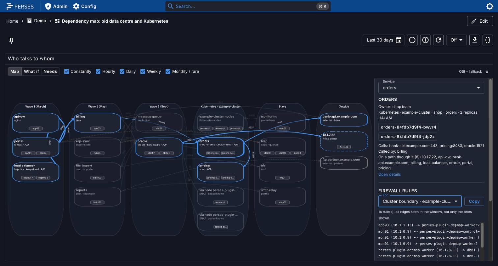

| Light theme, hybrid hop chain |
| --- |
| 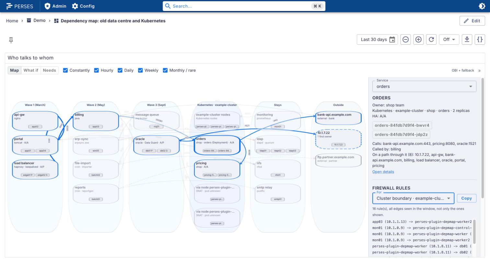 |

- **A Kubernetes lane** per cluster sits between the waves and what stays, because that is where the
  chains cross it. Workloads are grouped by namespace; each node of the cluster is an instance of a
  "nodes" group, so you can take one down.
- **Hop chains.** Selecting a service highlights its callers and callees on both sides of the
  boundary: `billing (VM) -> orders (pods, through node:30080) -> oracle (VM)`.
- **Identity.** A pod address becomes its workload, a Service ClusterIP the workload behind it, a node
  address its node, and anything else the VM or external from the mapping
  ([DECISIONS.md](docs/DECISIONS.md#15-identity-resolution-across-the-cluster-boundary)).
- **Egress SNAT.** Pods calling a VM leave with their node's address. OBI on the node sees both sides
  of that, and the panel stitches them: the edge is drawn from the pod's workload. Traffic from a node
  that no pod-side flow explains (no OBI there, or not at that time) is drawn honestly from
  **via node X (NAT, pod unknown)**, not guessed
  ([limits](docs/DECISIONS.md#16-stitching-snat-clusterip-and-nodeport-and-its-limits)).
- **What if** across the boundary: taking a Kubernetes node down takes its pods with it. A workload
  with fewer replicas than desired is degraded or down by its HA rule, with a note that Kubernetes
  reschedules the pods. A VM pinned to one node's NodePort (it only ever called that node) breaks with
  that node, even though the workload survives elsewhere.
- **Firewall rules** treat a cluster as a zone of its own. Pods are never in a rule: traffic out of
  the cluster comes from `egressIps`, else every node address (a pod can run on any node); traffic in
  goes to the node addresses on the NodePort (only the pinned node for a pinned caller) or to the
  LoadBalancer address.

## Map your legacy estate in 30 days

1. **Day 1: install the collectors.** On every Linux server whose kernel allows it, install OBI with
   `collect/obi/install.sh` (as root; it checks the kernel and stops if OBI cannot run). On container
   hosts, run OBI as a privileged container with the compose example. On Kubernetes, apply the
   DaemonSet: `kubectl apply -k collect/kubernetes/obi`, after setting the cluster name and your
   ranges in its `config.yaml`. Everywhere else, install the snapshot script with its systemd timer,
   cron entry or Windows scheduled task. Scrape them all from one Prometheus with at least 35 days of
   retention. Details: [collect/README.md](collect/README.md).
2. **Day 1: add the panel.** Install the plugin (below), add a **Dependency Map** panel with the
   Prometheus datasource and an empty mapping. Within minutes it shows unknown nodes, one per IP, and
   one node per Kubernetes workload. Check that every server you know appears; a missing one has
   no working collector.
3. **Week 1: write the mapping.** Start from `collect/mapping.example.yaml`. List services with their
   instances, owners and HA type. Every IP still shown as unknown is a question for someone: find its
   owner and add it as a service or an external. Add each cluster with its node names and the address
   each node has on the network the VMs see, and name the workloads that matter, with their desired
   replicas and NodePorts. Leave `wave` at 0 for now.
4. **Week 1: check the boundary.** Every **via node X (NAT, pod unknown)** node is pod traffic that
   OBI did not see from the pod side: that node has no OBI, or it was not running then. Fix the
   collector, then wait an hour. An address on a NodePort that is still unknown means the port is
   missing from `nodePorts`.
5. **Wait past a month-end.** Monthly and quarterly jobs only show up when they run. Keep the window at
   30 days and check again on the 2nd of the month: new dashed edges are the jobs nobody mentioned.
6. **Read the map.** In **What if**, open **Lose one server**: every entry is a single point of
   failure, Kubernetes nodes included. The hard-wired clients list shows callers that skip the VIP or
   call one node's NodePort; fix their configuration before the migration or they will break when
   their node moves. **Easy to miss** collects the rare edges and the addresses without an owner.
7. **Plan the waves.** Click a service, use **Needs** to see what must move with it, and set its wave
   in the details. The columns move live. When the plan holds, **Copy updated mapping** and paste it
   into the panel settings, so the plan is saved with the dashboard.
8. **Export the firewall rules.** Pick a wave in **Firewall rules**: the list is every connection that
   crosses zones once it moves, per instance, the cluster boundary included (node or egress addresses
   as sources, NodePorts and LoadBalancer addresses as destinations). Copy it into the change request.
   Repeat per wave.
9. **Remove the collectors** after the migration: `collect/obi/install.sh --remove`,
   `kubectl delete -k collect/kubernetes/obi`, and the removal steps for the container and the script
   in [collect/README.md](collect/README.md). Nothing else was changed on the servers.

## Try it locally

The [dev/](dev/) stack starts Perses with the plugin, Prometheus with 30 days of history, and a fake
legacy estate: twenty containers acting as servers (a load balancer, an api gateway, a two-node
portal, billing, a Windows ERP sync, two batch servers, an Oracle primary, a message queue, a
three-node LDAP, NFS, SMTP, two VIPs, two external partners and one address nobody owns). Their
traffic follows [dev/estate/flows.tsv](dev/estate/flows.tsv); their mapping is
[dev/estate/mapping.yaml](dev/estate/mapping.yaml).

It contains the cases the panel is for:

- two hard-wired clients: the portal (both nodes) talks to `ldap01` only, and erp-sync to the Oracle
  primary `db01` instead of the VIP;
- a monthly job: `reports` uploads to a partner FTP on the last day of the month. The servers run on a
  clock 1440 times faster than real time that starts on 30 November 22:00 UTC, so the job runs a few
  seconds after start-up;
- an unknown address (`10.1.7.22`) that the Oracle server calls every night.

**The VMs collect with the fallback script, not OBI.** OBI needs to create eBPF maps, and a rootless
podman container cannot, even on a kernel with BTF (details in
[docs/DECISIONS.md](docs/DECISIONS.md#3-obi-in-dev-rootless-podman-cannot-the-podman-machine-can)).

```bash
npm ci
percli plugin build                    # writes DepMap-0.3.0.tar.gz
cp DepMap-0.3.0.tar.gz dev/archive/
cd dev
podman compose up -d --build           # or docker compose
```

Open <http://localhost:18087/projects/demo/dashboards/dependency-map>. Prometheus is on
<http://localhost:18187>. Stop it with `podman compose down -v`.

The live part of the history runs on the fast clock, so the most recent hours look busier than they
are; the month before it was backfilled at normal speed.

### The hybrid estate

`dev/hybrid.sh up` adds a three-node [kind](https://kind.sigs.k8s.io) cluster to the same stack. Its
nodes join the old data centre's network as `10.1.8.10` to `10.1.8.12`. Namespace `shop` runs
`orders` (two replicas, NodePort 30080) and `pricing`; orders calls pricing through its Service, the
Oracle VIP and the bank API. Billing (`app03`, a VM) calls the orders NodePort on `10.1.8.12`. That
gives the chain `lb -> api -> portal -> billing (VM) -> orders (pods) -> oracle (VM)`.

```bash
cd dev
DEPMAP_KUBECONFIG=$PWD/.kubeconfig ./hybrid.sh up    # compose up, kind cluster, workloads, OBI, history
./hybrid.sh down                                     # cluster, OBI and the compose stack with its data
```

Needs `kind`, `kubectl` and node.js. Settings: `COMPOSE` (default `podman compose`),
`KIND_EXPERIMENTAL_PROVIDER` (default `podman`), `DEPMAP_KUBECONFIG` (default `dev/.kubeconfig`; your
own kubeconfig is never touched) and `DEPMAP_OBI=daemonset|machine`.

What is real and what is synthetic:

| Part | |
| --- | --- |
| OBI on the kind nodes | **Real.** OBI v1.0.0 with Kubernetes metadata, the config from `collect/kubernetes/obi`. With a rootful runtime it is that DaemonSet. Under rootless podman it cannot create eBPF maps, so `hybrid.sh` runs the same image rootful inside the podman machine, in each node's network namespace: what a host-network DaemonSet sees |
| Pod to Service, pod to pod, pod to VM, node SNAT, VM to NodePort | **Seen live** by that OBI: the pod side and the SNATed node side of the Oracle and bank calls, the ClusterIP call and its DNAT twin, and `app03 -> 10.1.8.12:30080` on worker2 |
| 30 days of Kubernetes history | **Synthetic** (`dev/backfill-k8s.mjs`), written with the label sets OBI really reported. It includes two weeks before OBI was "installed", where only the database's fallback script saw the nodes connect: those show as NAT, pod unknown |
| The VMs | Fallback script, as above. Its one-minute snapshot misses billing's short NodePort connections; that edge's history comes from the backfill |

## Install into Perses

Perses extracts every `*.tar.gz` in `plugin.archive_paths` into `plugin.path` at startup. Setting
`archive_paths` replaces the default, so keep the directory of bundled plugins in the list. Pick one
of the options below and restart Perses.

### Option A: release archive

Download `DepMap-<version>.tar.gz` from the
[GitHub releases](https://github.com/astrona-io/perses-plugin-depmap/releases), put it in a directory
Perses can read, and add that directory to the config:

```bash
curl -fLO https://github.com/astrona-io/perses-plugin-depmap/releases/download/v0.3.0/DepMap-0.3.0.tar.gz
curl -fLO https://github.com/astrona-io/perses-plugin-depmap/releases/download/v0.3.0/DepMap-0.3.0.tar.gz.sha256
sha256sum -c DepMap-0.3.0.tar.gz.sha256
```

```yaml
plugin:
  archive_paths:
    - /etc/perses/plugins-archive # plugins bundled with Perses
    - /etc/perses/plugins-archive-depmap # put DepMap-0.3.0.tar.gz here
```

### Option B: Kubernetes image volume

The `Containerfile` packages the archive as a plugin-only OCI image (`FROM scratch`, the archive at the
image root). Every release publishes it as `ghcr.io/astrona-io/perses-plugin-depmap:v<version>` for
linux/amd64 and linux/arm64. Mount it into the Perses pod as an
[image volume](https://kubernetes.io/docs/concepts/storage/volumes/#image) and add the mount path to
`archive_paths` as in option A. Image volumes need a cluster and container runtime that support them
(the `ImageVolume` feature).

```yaml
volumes:
  - name: depmap-plugin
    image:
      reference: ghcr.io/astrona-io/perses-plugin-depmap:v0.3.0
      pullPolicy: IfNotPresent
containers:
  - name: perses
    volumeMounts:
      - name: depmap-plugin
        mountPath: /etc/perses/plugins-archive-depmap
        readOnly: true
```

To build it for your own registry instead:

```bash
percli plugin build
podman build -t ghcr.io/<owner>/perses-plugin-depmap:<version> .
```

### Option C: custom Perses image

Copy the archive into the directory of bundled plugins. No config change is needed:

```dockerfile
FROM persesdev/perses:v0.55.1
COPY DepMap-0.3.0.tar.gz /etc/perses/plugins-archive/
```

## Development

See [CONTRIBUTING.md](CONTRIBUTING.md). In short: `npm ci`, then `npm run lint`, `npm run type-check`,
`npm test`, `percli plugin test-schemas` and `percli plugin build`. The design is in
[docs/PLAN.md](docs/PLAN.md), the choices made along the way in [docs/DECISIONS.md](docs/DECISIONS.md),
and the original spec in [docs/PROMPT.md](docs/PROMPT.md).

## Licences and credits

The plugin is Apache-2.0 (`LICENSE`). Third-party material and its notices are listed in `NOTICE`.
The graph canvas, pan and zoom and theming come from
[perses-plugin-servicegraph](https://github.com/astrona-io/perses-plugin-servicegraph).
